  
# 👋 Hello, World! I'm a R&D Engineer.

**CS Master | LLM Explorer | Blog Expert (CSDN)**

*“Exploring the depth of Artificial Intelligence and Large Language Models.”*

`Data · Model · Agent · Repeat.` 🔁

---

### 🧑‍💻 About Me

- 💼 **Background**: 本科（计算机科学与技术），硕士（计算机技术），目前在一家互联网公司做研发，也在 CSDN 写写技术博客。
- 🔭 **Current Focus**: 关注云计算、大数据、人工智能等方向前沿技术发展，希望能做好底层的技术打通与工程落地。
- 🌱 **Learning**: 正在大模型的浪潮里持续学习中，相比于宏大的概念，更关注技术到底能在实际业务里解决什么具体问题。
- ✍️ **Writing**: 公众号 **「大模型AI深研录」** 是我的技术自留地。记录一些平时的阅读、踩坑实录和对 AI 的深度思考，不定期更新，主打一个真实记录。
- 💬 **Ask me about**: Cloud Native, LLM Applications, AI Agents, or why my code worked on the first try. (Just kidding 😉)

---

### 🛠️ Tech Stack

| 领域 / Domain | 技能栈 / Skills |
| :--- | :--- |
| **Cloud & Infra** |    |
| **AI & LLM** |     |
| **Backend** |   |

---

### 📊 GitHub Stats

<picture>
  <source media="(prefers-color-scheme: dark)" srcset="https://raw.githubusercontent.com/AI-ShenYan/AI-ShenYan/main/profile/stats.svg">
  <source media="(prefers-color-scheme: light)" srcset="https://raw.githubusercontent.com/AI-ShenYan/AI-ShenYan/main/profile/stats.svg">
  
</picture>

<picture>
  <source media="(prefers-color-scheme: dark)" srcset="https://raw.githubusercontent.com/AI-ShenYan/AI-ShenYan/main/profile/top-langs.svg">
  <source media="(prefers-color-scheme: light)" srcset="https://raw.githubusercontent.com/AI-ShenYan/AI-ShenYan/main/profile/top-langs.svg">
  
</picture>

---

  
*“The best way to predict the future is to invent it.” – Alan Kay* 

**Thanks for dropping by! ⭐️ Let's build the future of AI together.**

